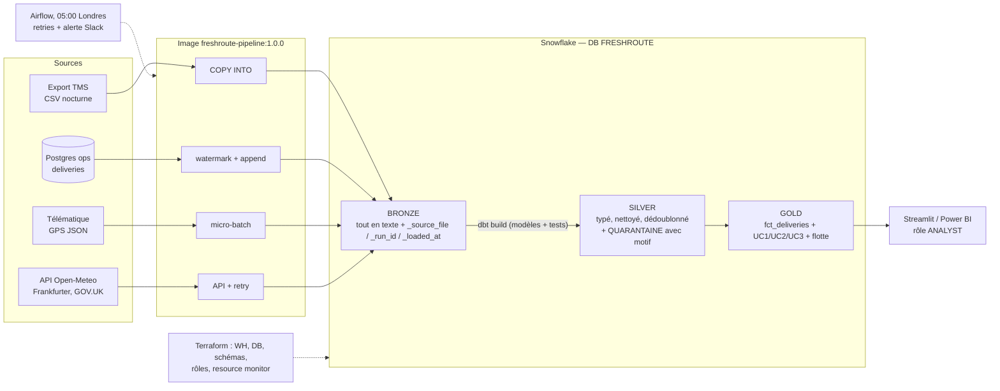

# FreshRoute Logistics

## 1. L'entreprise

**FreshRoute Logistics** livre les commandes de courses en ligne de supermarchés partenaires, depuis **8 dépôts** (Londres ×2, Birmingham, Manchester, Leeds, Bristol, Belfast, Paris) avec **~130 véhicules** (petites et grandes camionnettes, camionnettes électriques, camions frigorifiques). Elle appartient à un groupe européen qui suit ses résultats en euros.

| | |
|---|---|
| Business model | Le supermarché paie FreshRoute **par livraison réussie** (frais de 1 à 10 £, selon le poids et le créneau). Une livraison refusée, abîmée ou « client absent » **n'est pas facturée**, et il faut la refaire. |
| Clients | 5 enseignes de supermarché, environ 60 000 clients finaux |
| Volume | ~9 000 livraisons et ~2 400 tournées par mois ; 15 000 pings GPS/jour (télématique des véhicules) |
| Parties prenantes | Responsables de dépôt, directeur des opérations, gestionnaire de flotte, CFO (reporting groupe en EUR) |

**Problème :** les livraisons sont dans la base opérationnelle (Postgres on-prem), les tournées dans l'export nocturne du logiciel de transport (TMS), le GPS dans un flux télématique, la météo et le change ailleurs. Personne ne sait **quel dépôt rate ses promesses de livraison**, si **la pluie** y est pour quelque chose, ni **combien d'argent** est perdu en livraisons ratées.

**Hypothèses explicites :** objectif contractuel **OTIF ≥ 85 %** par dépôt ; une livraison ratée coûte au moins ses frais non facturés ; les frais saisis au-delà de 50 £ sont des pence saisis comme des livres (÷ 100).

## 2. Use cases

| # | Décision / Utilisateur | Métrique : grain · formule · exclusions | Fréquence | Test d'acceptation |
|---|---|---|---|---|
| UC1 | **Responsable de dépôt** : quel dépôt et quel jour rate sa promesse, pour réaffecter des chauffeurs | **OTIF** · grain = jour ouvré (date promise, heure de Londres) × `depot_id` · `livrées avant promised_by / livraisons dues` · exclut les lignes en quarantaine | Quotidienne, 05:00 Londres | Recalculer l'OTIF d'un dépôt et d'un jour en SQL depuis `silver_deliveries` = valeur du dashboard |
| UC2 | **Directeur des opérations** : renforcer les tournées les jours de pluie ? | **Taux de succès et retard moyen** par catégorie de pluie (sec, pluie légère, forte > 10 mm) · grain = dépôt × catégorie · exclut les jours sans météo | Hebdomadaire | Le nombre de livraisons par catégorie de pluie = le total de `fct_deliveries` |
| UC3 | **CFO** : frais facturés et manque à gagner, en EUR pour le groupe | **Frais facturés et frais perdus** · grain = semaine × dépôt · EUR = GBP × taux BCE moyen de la semaine | Hebdomadaire | Test dbt `assert_gold_matches_silver` : le total Gold = le total Silver, au penny près |
| (+) | **Gestionnaire de flotte** : quels véhicules sont sous-utilisés ? | Part des pings GPS en mouvement · grain = jour × véhicule | Quotidienne | Le nombre de pings dans Gold = le nombre de pings dans Silver |

## 3. Sources et méthodes d'ingestion (6 sources logiques, 5 méthodes)

| # | Source | Rôle | Méthode | Pourquoi ce mode | Job |
|---|---|---|---|---|---|
| 1 | Export TMS : `depots`, `vehicles`, `routes` (CSV) | Référentiel et tournées | **Batch fichiers** : `PUT` → stage → `COPY INTO` | Export nocturne, décision quotidienne | `load_files_batch.py` |
| 2 | Postgres `ops.deliveries` (Docker) | Base opérationnelle (OLTP) | **Pull incrémental** : watermark `_pg_loaded_at` | On ne veut que le delta ; le CDC serait justifié s'il y avait des suppressions physiques | `load_deliveries_incremental.py` |
| 3 | Pings GPS (JSON) | Flux télématique | **Micro-batch streaming** : envoi par paquets toutes les secondes, avec reprise | Simule Kafka/Snowpipe Streaming à moindre coût | `stream_gps_pings.py` |
| 4 | [Open-Meteo Archive](https://open-meteo.com/en/docs/historical-weather-api) | Météo quotidienne de chaque ville de dépôt | **API REST** → VARIANT | Données publiques, pas de clé | `load_weather_api.py` |
| 5 | [Frankfurter](https://frankfurter.dev) (BCE) | Taux GBP → EUR | **API REST** | Reporting groupe en EUR | `load_fx_api.py` |
| 6 | [GOV.UK bank holidays](https://www.gov.uk/bank-holidays.json) | Jours fériés (Angleterre, Irlande du Nord…) | **API REST** | Expliquer les creux d'activité | `load_bank_holidays_api.py` |
| + | `seeds/depot_cities.csv`, `seeds/category_mapping.csv` | Coordonnées des villes, table de correspondance des catégories | **Seed dbt** | Petits référentiels versionnés | `dbt seed` |

## 4. Architecture



### Règles de nettoyage (Silver)

Elles suivent le cookbook du cours :
- **Bronze** garde tout tel que reçu.
- **Silver** type, nettoie et dédoublonne, et envoie les lignes irréparables en **quarantaine avec leur motif**.
- **Gold** ne lit que Silver.

| Problème dans les données | Correction |
|---|---|
| `N/A`, `null`, `-`, `" "` | macro `clean_text` → NULL |
| Dates : ISO `Z`, `+01:00`, sans fuseau, epoch, `dd/mm/yyyy` ; 1970/2099 | macro `clean_ts`, stockage en UTC, jour ouvré à l'heure de Londres |
| `£1,234.50`, `€5.30`, `12,50`, montants négatifs, pence ×100 | `clean_money` ; valeur absolue + drapeau `fee_sign_error` ; ÷ 100 au-delà de 50 £ |
| `5,66`, `25.8 units`, poids négatif | `clean_float` ; hors de ]0, 100] kg → NULL (le poids n'entre dans aucun KPI, donc NULL plutôt que quarantaine) |
| `DELIVERED`, `failed_-_not_home`, `delivereds` | normalisation + seed `category_mapping` |
| FK orpheline (tournée inconnue), id manquant, issue inconnue, date promise illisible, frais illisibles | **quarantaine** avec la liste des problèmes |
| JSON GPS cassé, `LAT` au lieu de `lat`, `"NULL"` | `TRY_PARSE_JSON` + `COALESCE(p:lat, p:LAT)` |
| Doublons exacts ou quasi-doublons, mises à jour des jours suivants | `QUALIFY ROW_NUMBER()`, avec ordre de priorité : **dernier batch**, puis dernier pull, puis départages déterministes |
| Schema drift (`outcome` → `outcome_v2`, `payload_v2`, `source_system`) | Renommage connu mappé dans l'ingestion ; **colonne inconnue → warning** dans les logs |

Résultat attendu avec le seed 42 et 3 batches : **~4 % des livraisons en quarantaine**, sous le seuil de 15 % du test `assert_quarantine_below_15_percent`.

### Justification des choix (C4)

- **Snowflake** : stockage et compute séparés ; warehouse XS en auto-suspend à 60 s ; `COPY INTO` idempotent (fichiers mémorisés 64 jours) ; VARIANT pour le JSON. *Alternative :* BigQuery, serverless et payé au volume scanné, mais l'équipe maîtrise Snowflake et le pack du cours y est testé.
- **dbt Core 1.11** : versionné, testé, lineage via `dbt docs`, macros de nettoyage réutilisables. *Alternative :* Dynamic Tables, plus simples mais sans les tests ni la quarantaine.
- **Docker** : une seule image figée pour tous les jobs et pour dbt, utilisateur non-root, aucun secret dans l'image.
- **Airflow** : dépendances, retries, alertes, rejeu d'un jour. *Alternative légère :* Snowflake Tasks.
- **Terraform** : warehouse, base, schémas, rôles et resource monitor en code, avec un state distant.
- **Pourquoi pas Kafka ni CDC Debezium ?** Aucune décision n'est prise en temps réel (point quotidien à 08:00). On simule le streaming GPS en micro-batch ; un vrai CDC ne deviendrait utile que si la base d'ops supprimait physiquement des lignes.

## 5. Lancer le projet

```bash
# 0. Préparation
cp .env.example .env                                  # identifiants Snowflake (key pair) et Postgres
cp dbt/freshroute/profiles.yml.example dbt/freshroute/profiles.yml
mkdir -p secrets                                      # y mettre rsa_key.p8 (jamais commitée)
python tools/messy_data.py --company freshroute --batches 3 --seed 42 --out data
# 1. Infra (Terraform)
cd terraform && terraform init && terraform plan && terraform apply && cd ..
# 2. Tables Bronze et stage (une fois) : exécuter sql/setup.sql dans un worksheet Snowflake
# 3. Pipeline, jour par jour
docker compose build
docker compose up -d postgres
./run_pipeline.sh 1          # jour 1 : chargement initial
./run_pipeline.sh 2          # jour 2 : nouvelles lignes, mises à jour, schema drift
./run_pipeline.sh 3
# 4. Dashboard
streamlit run dashboard/streamlit_app.py
```

## 6. Incidents et résilience (C6)

| # | Scénario | Ce qui se passe | Démo |
|---|---|---|---|
| 1 | **API indisponible** | 3 tentatives avec backoff, puis échec bruyant ; `run_pipeline.sh` s'arrête et envoie une **alerte** (Slack, ou console sans webhook) ; dbt ne tourne pas | `WEATHER_API_URL=https://example.invalid ./run_pipeline.sh 1` |
| 2 | **Rejeu du même jour** (retry, double clic) | `COPY INTO` charge 0 fichier, le watermark ramène 0 ligne, le GPS reprend là où il s'était arrêté, les API font delete + insert → **aucun double comptage** | `./run_pipeline.sh 2` deux fois, puis `sql/checks.sql` (les totaux ne bougent pas) |
| 3 | **Jour corrompu dans la source** (toutes les tournées inconnues) | Tout part en quarantaine, le taux dépasse 15 %, le test échoue, `dbt build` **saute Gold** : le dashboard garde les chiffres de la veille, qui sont justes | `python tools/inject_bad_batch.py` → `./run_pipeline.sh 3` (échec) → `python tools/inject_bad_batch.py --rollback` → `./run_pipeline.sh 3` (vert) |
| 4 | **Schema drift** (`outcome_v2`) | Le renommage connu est mappé ; une colonne inconnue déclenche un warning sans bloquer | Logs du jour 2 |

Contrôles qualité :
- **Clés** : `unique` et `not_null` ;
- **Complétude** : `relationships` entre livraisons et tournées ;
- **Règles métier** : frais entre 0 et 50 £, quarantaine sous 15 %, réconciliation Gold = Silver ;
- **Grain des tables Gold** : test générique `unique_combination`, sans package ;
- **Fraîcheur** : `dbt source freshness`.

## 7. Sécurité et coûts (C7)

- **Rôles** : `FRESHROUTE_ENGINEER` (pipeline) et `FRESHROUTE_ANALYST`, qui ne lit que GOLD. Vérification avec `sql/checks.sql` §6 : la lecture de Bronze est **refusée**, celle de Gold est **autorisée**.
- **Secrets** : clé privée montée à l'exécution, `.env` et `*.p8` ignorés par Git et par Docker. Les clients sont pseudonymisés (`customer_ref`), sans nom ni adresse.
- **Coût du prototype** : warehouse XS = 1 crédit/heure ; ~6 min par run, soit ~3 crédits/mois pour un run quotidien (≈ 6-9 $) ; stockage < 1 Go. **Projection** avec 10 fois plus de dépôts : ~30 crédits/mois, toujours en XS.
- **Garde-fou** : resource monitor de 10 crédits/mois, avec notification à 75 % et suspension à 100 % (Terraform). Rappel : une alerte budget n'est pas un plafond, c'est la suspension qui en fait un.
- **Nettoyage** : `terraform destroy` (après la soutenance) et `docker compose down -v`.
- **Étapes manuelles restantes** : compte Snowflake et premier admin ; bucket du state Terraform ; enregistrement de la clé publique RSA sur l'utilisateur de service.

## 8. Répartition de l'équipe

| Membre | Possède |
|---|---|
| Nicolas Dollet | Ingestion : fichiers, incrémental, stream GPS, API + Docker |
| Naye Kanoute | dbt : nettoyage Silver, quarantaine, modèles Gold, tests, docs |
| Danila Zhekhovskii | Terraform, Airflow, alertes, dashboard, coûts |

*Ressources du cours réutilisées :* `tools/messy_data.py` (générateur), macros `clean_text`, `clean_int`, `clean_money` et `clean_ts` (cookbook de nettoyage), et le loader Postgres (adapté).# freshroute-data-engineering
